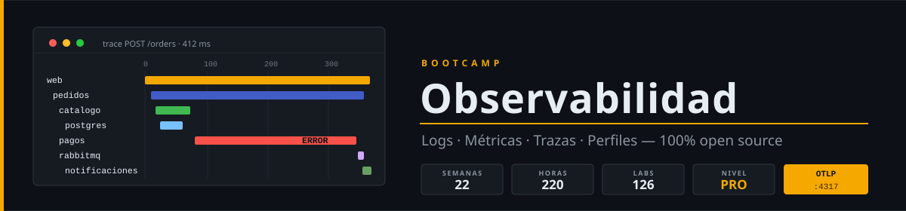

<p align="center">
  
</p>

<p align="center">
  <a href="LICENSE"></a>
  <a href="#"></a>
  <a href="#"></a>
  <a href="#"></a>
  <a href="#"></a>
  <a href="#"></a>
</p>

<p align="center">
  <a href="README_EN.md"></a>
</p>

---

## 📋 Descripción

Bootcamp **Zero to Advanced** de **22 semanas (~5 meses)** sobre **observabilidad con herramientas open source**. Autoestudio asincrónico, **10 h/semana**, 100% práctico. Empiezas depurando una tienda de microservicios a ciegas y terminas operando una plataforma completa: logs, métricas, trazas y perfiles con OpenTelemetry, alertas que no despiertan a nadie por nada, SLOs con error budget, escala, Kubernetes e IA aplicada al análisis de la telemetría.

### 🎯 Objetivos

Al finalizar el bootcamp serás capaz de:

- ✅ Explicar la diferencia entre monitoreo y observabilidad y aplicar RED, USE y las golden signals
- ✅ Emitir logs estructurados con esquema común y correlación entre servicios
- ✅ Instrumentar métricas y responder preguntas reales con PromQL y recording rules
- ✅ Construir dashboards como código y alertas probadas, con runbooks y enrutado
- ✅ Centralizar logs en Loki y consultarlos con LogQL
- ✅ Trazar peticiones de punta a punta con OpenTelemetry, incluida la mensajería asíncrona
- ✅ Diseñar pipelines con el OpenTelemetry Collector: redacción de PII, muestreo y control de coste
- ✅ Saltar de una métrica a su traza, a sus logs y a su perfil en segundos
- ✅ Definir SLOs con alertas de burn rate y detectar anomalías
- ✅ Escalar con Thanos, llevar todo a Kubernetes y asegurar el propio stack
- ✅ Observar aplicaciones con LLM y usar IA local como copiloto de la investigación
- ✅ Resolver incidentes con método y escribir postmortems sin culpables

### 🔧 ¿Por qué solo open source?

> Todo lo que aprendes aquí lo puedes desplegar mañana sin pedir presupuesto.

OpenTelemetry es el estándar de facto para emitir telemetría, y Prometheus, Grafana, Loki, Jaeger y Tempo son lo que corre debajo de buena parte de las plataformas comerciales. Aprender la capa abierta te deja independiente del proveedor: el día que cambias de backend, la instrumentación se queda.

---

## 🗓️ Estructura del Bootcamp

| Fase | Semanas | Horas | Temas principales |
|:--:|:--:|:--:|---|
| **Fundamentos: logs y métricas** | 1-4 | 40 h | Señales, logs estructurados, Prometheus, PromQL |
| **Visualización, alertas y logs** | 5-8 | 40 h | Recording rules, Grafana como código, Alertmanager, Loki |
| **Trazas y OpenTelemetry** | 9-13 | 50 h | Trazas, auto-instrumentación, Collector, Tempo, muestreo |
| **Señales avanzadas y fiabilidad** | 14-16 | 30 h | Profiling y eBPF, SLOs, dependencias y frontend |
| **Plataforma en producción** | 17-22 | 60 h | Thanos, Kubernetes, seguridad, IA, incidentes, capstone |

**Total: 22 semanas** | **220 horas** | Índice con el estado de cada semana: [bootcamp/README.md](bootcamp/README.md) · Temario detallado: [docs/temario.md](docs/temario.md)

---

## 📚 Contenido por Semana

Cada semana incluye:

```
bootcamp/week-NN-nombre_del_tema/
├── README.md                  # Descripción, objetivos y navegación
├── rubrica-evaluacion.md      # Conocimiento 30% / Desempeño 40% / Producto 30%
├── checks.json                # Comprobaciones automáticas (autograding)
├── 0-assets/                  # Diagramas SVG
├── 1-teoria/                  # Contexto mínimo (≤ 45 min)
├── 2-practicas/               # 6 labs progresivos (~60 min c/u)
├── 3-proyecto/                # La capa semanal de la tienda (3 h)
├── 4-recursos/                # Ebooks, videografía y webgrafía
└── 5-glosario/                # Términos clave de la semana
```

### 🗺️ Plan de 22 Semanas

| Semana | Tema |
|:--:|---|
| 01 | Qué es observabilidad: señales, RED, USE y golden signals |
| 02 | Logs estructurados con structlog y pino |
| 03 | Métricas e instrumentación con Prometheus |
| 04 | PromQL: fundamentos |
| 05 | PromQL avanzado y recording rules |
| 06 | Grafana y dashboards como código |
| 07 | Alertas y Alertmanager |
| 08 | Logs centralizados con Loki y patrones de logs |
| 09 | Trazas distribuidas e instrumentación manual con Jaeger |
| 10 | OpenTelemetry: auto-instrumentación y propagación |
| 11 | OpenTelemetry Collector |
| 12 | Tempo y correlación de señales |
| 13 | Muestreo, cardinalidad y coste |
| 14 | Profiling continuo y eBPF |
| 15 | SLOs, error budgets y anomalías |
| 16 | Observabilidad de dependencias y frontend |
| 17 | Escala y alta disponibilidad con Thanos |
| 18 | Observabilidad en Kubernetes |
| 19 | Seguridad, gobernanza y meta-monitoreo |
| 20 | IA aplicada a la observabilidad |
| 21 | Respuesta a incidentes y troubleshooting |
| 22 | Proyecto integrador |

### 🛒 Proyecto hilo conductor: `tienda`

Una tienda de microservicios que recibes **sin instrumentar** y que observas un poco más cada semana: `catalogo`, `pedidos`, `pagos` y `asistente` en FastAPI, `notificaciones` en Express, un frontend `web`, PostgreSQL, Valkey y RabbitMQ. `pagos` trae averías configurables para que tengas algo real que diagnosticar. Detalle: [docs/proyecto-hilo-conductor.md](docs/proyecto-hilo-conductor.md).

### 🔑 Componentes clave

- 📖 **Teoría**: contexto mínimo indispensable (máx. 45 min/semana)
- 💻 **Práctica**: 6 labs progresivos con starter y criterios de éxito verificables
- 🐛 **Averías inyectadas**: diagnosticas fallos reales con la señal de cada semana
- 🤖 **Autograding**: `./scripts/verificar-semana.sh NN` comprueba tu trabajo ([cómo funciona](docs/autograding.md))
- 🎓 **Recursos**: glosario, ebooks gratuitos, videografía y webgrafía

---

## 🛠️ Herramientas

Todas open source. Versiones fijadas y fuente de cada una: [docs/stack-versions.md](docs/stack-versions.md).

| Área | Herramientas |
|---|---|
| Instrumentación | OpenTelemetry (SDK Python y Node.js, Collector, OBI), structlog, pino |
| Métricas y alertas | Prometheus, Alertmanager, exporters, Thanos, Sloth |
| Logs | Loki, Fluent Bit |
| Trazas | Jaeger, Tempo |
| Perfiles | Pyroscope |
| Visualización | Grafana |
| Kubernetes | kind, Helm, kube-prometheus-stack, OpenTelemetry Operator |
| IA local | Ollama, OpenLLMetry, Langfuse, mcp-grafana, HolmesGPT, K8sGPT |
| Carga y caos | k6, toxiproxy |
| App | Python + **uv** (nunca pip), FastAPI · Node.js + **pnpm** (nunca npm), Express |
| Entorno | Docker Engine + plugin `docker compose`, bash, jq, curl |

> ⚠️ **RAM:** el laboratorio va por perfiles para no pasar de ~8 GB. Las semanas de escala, Kubernetes e IA piden más: [docs/perfiles-de-laboratorio.md](docs/perfiles-de-laboratorio.md).

---

## 🚀 Inicio Rápido

```bash
git clone https://github.com/ergrato-dev/bc-observability.git
cd bc-observability
./scripts/verificar-semana.sh --doctor     # comprueba tu entorno
```

Empieza por la Semana 01 desde el [índice del bootcamp](bootcamp/README.md). Trabajas en las carpetas `starter/`; al terminar la semana, desde la raíz del repositorio:

```bash
./scripts/verificar-semana.sh 01
```

---

## ⚠️ Exención de Responsabilidad

Este repositorio es un recurso **educativo** creado con fines de aprendizaje. Al utilizarlo, aceptas los siguientes términos:

- **Solo fines educativos**: El contenido, los ejemplos de código y los proyectos están diseñados exclusivamente para la enseñanza y el aprendizaje. No constituyen asesoramiento profesional, legal ni de seguridad.
- **Sin garantías**: El material se proporciona **"tal cual"**, sin garantías de ningún tipo, expresas o implícitas, incluyendo idoneidad para un propósito particular o ausencia de errores.
- **Código en producción**: Los ejemplos de código y las configuraciones de observabilidad son ilustrativos. Antes de usarlos en entornos productivos, debes realizar revisiones de seguridad, rendimiento, coste y adaptación a tu contexto específico.
- **Averías y pruebas de carga**: Las averías inyectadas (toxiproxy, `pagos`) y las pruebas de carga con k6 están pensadas para el laboratorio local. No las ejecutes contra sistemas que no sean tuyos o sin autorización expresa.
- **Datos personales**: Los datos de la tienda son ficticios. Si aplicas lo aprendido a sistemas reales, eres responsable de cumplir la normativa de protección de datos que corresponda a la telemetría que recojas.
- **Versiones de software**: Las versiones de herramientas mencionadas pueden quedar desactualizadas. Siempre consulta la documentación oficial más reciente.
- **Limitación de responsabilidad**: Los autores y contribuidores no se responsabilizan por pérdidas de datos, daños directos o indirectos, interrupciones de servicio ni cualquier otro perjuicio derivado del uso de este material.
- **Responsabilidad del estudiante**: Cada estudiante es responsable de sus propias implementaciones, entornos de desarrollo y decisiones técnicas.

---

## 📄 Licencia

[CC BY-NC-SA 4.0](LICENSE). Este repositorio no acepta pull requests externos; si encuentras un error, abre un issue. Seguridad: [SECURITY.md](SECURITY.md).
