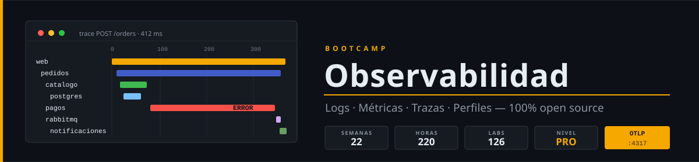

<p align="center">
  
</p>

<p align="center">
  <a href="LICENSE"></a>
  <a href="#"></a>
  <a href="#"></a>
  <a href="#"></a>
  <a href="#"></a>
  <a href="#"></a>
</p>

<p align="center">
  <a href="README.md"></a>
</p>

---

> The course content is written in **Spanish**. This page summarizes it for English readers.

## 📋 Description

A **22-week Zero to Advanced** bootcamp (~5 months) on **observability with open source tools**. Self-paced, **10 h/week**, 100% hands-on. You start debugging a microservices shop blind and finish operating a full platform: logs, metrics, traces and profiles with OpenTelemetry, alerts that only page for real problems, SLOs with error budgets, scale, Kubernetes, and AI applied to telemetry analysis.

## 🗓️ Structure

| Phase | Weeks | Hours | Main topics |
|:--:|:--:|:--:|---|
| **Foundations: logs and metrics** | 1-4 | 40 h | Signals, structured logs, Prometheus, PromQL |
| **Visualization, alerting and logs** | 5-8 | 40 h | Recording rules, Grafana as code, Alertmanager, Loki |
| **Traces and OpenTelemetry** | 9-13 | 50 h | Tracing, auto-instrumentation, Collector, Tempo, sampling |
| **Advanced signals and reliability** | 14-16 | 30 h | Profiling and eBPF, SLOs, dependencies and frontend |
| **Production platform** | 17-22 | 60 h | Thanos, Kubernetes, security, AI, incidents, capstone |

| Week | Topic |
|:--:|---|
| 01 | What observability is: signals, RED, USE and golden signals |
| 02 | Structured logs with structlog and pino |
| 03 | Metrics and instrumentation with Prometheus |
| 04 | PromQL fundamentals |
| 05 | Advanced PromQL and recording rules |
| 06 | Grafana and dashboards as code |
| 07 | Alerting and Alertmanager |
| 08 | Centralized logs with Loki and log patterns |
| 09 | Distributed tracing and manual instrumentation with Jaeger |
| 10 | OpenTelemetry: auto-instrumentation and propagation |
| 11 | OpenTelemetry Collector |
| 12 | Tempo and signal correlation |
| 13 | Sampling, cardinality and cost |
| 14 | Continuous profiling and eBPF |
| 15 | SLOs, error budgets and anomalies |
| 16 | Dependency and frontend observability |
| 17 | Scale and high availability with Thanos |
| 18 | Observability on Kubernetes |
| 19 | Security, governance and meta-monitoring |
| 20 | AI applied to observability |
| 21 | Incident response and troubleshooting |
| 22 | Capstone project |

Each week: minimal theory (≤ 45 min), 10 knowledge questions, 6 labs (~60 min each) and a 3 h project that adds one layer to `tienda`, the uninstrumented microservices app every week builds on. Assessment: Knowledge 30% / Performance 40% / Product 30%, at least 70% in each. Autograding: `./scripts/verificar-semana.sh NN`.

## 🛠️ Tools

All open source: OpenTelemetry, Prometheus, Alertmanager, Thanos, Sloth, Loki, Fluent Bit, Jaeger, Tempo, Pyroscope, Grafana, kind, Helm, Ollama, OpenLLMetry, Langfuse, k6, toxiproxy. Python always with **uv** + FastAPI, Node.js always with **pnpm**. Pinned versions: [docs/stack-versions.md](docs/stack-versions.md).

## 🚀 Quick start

```bash
git clone https://github.com/ergrato-dev/bc-observability.git
cd bc-observability
./scripts/verificar-semana.sh --doctor
```

## ⚠️ Disclaimer

This repository is an **educational** resource created for learning purposes. By using it, you agree to the following terms:

- **Educational purposes only**: The content, code examples, and projects are designed exclusively for teaching and learning. They do not constitute professional, legal, or security advice.
- **No warranties**: The material is provided **"as is"**, without warranties of any kind, express or implied, including fitness for a particular purpose or freedom from errors.
- **Production code**: Code examples and observability configurations are illustrative. Before using them in production environments, you must perform security, performance, cost, and context-specific reviews.
- **Fault injection and load tests**: The injected faults (toxiproxy, `pagos`) and the k6 load tests are meant for the local lab. Do not run them against systems you do not own or without explicit authorization.
- **Personal data**: The store data is fictitious. If you apply what you learn to real systems, you are responsible for complying with the data protection regulations that apply to the telemetry you collect.
- **Software versions**: Tool versions mentioned may become outdated. Always consult the latest official documentation.
- **Limitation of liability**: The authors and contributors are not responsible for data loss, direct or indirect damages, service interruptions, or any other harm arising from the use of this material.
- **Student responsibility**: Each student is responsible for their own implementations, development environments, and technical decisions.

---

## 📄 License

[CC BY-NC-SA 4.0](LICENSE). External pull requests are not accepted; please open an issue instead.
