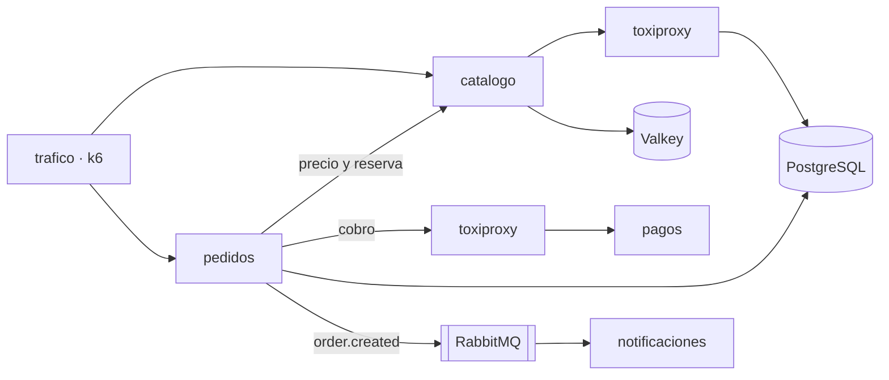

# 🛒 tienda — app del laboratorio

La app sobre la que trabajas las 22 semanas. Llega **sin instrumentar**: solo logs de texto plano, sin `/metrics` y sin trazas. Cada semana le añades una capa ([`docs/proyecto-hilo-conductor.md`](../docs/proyecto-hilo-conductor.md)).



## Levantar y probar

Desde la raíz del repositorio:

```bash
./scripts/lab-up.sh              # construye y arranca la tienda (perfil core)
./app/scripts/smoke-test.sh      # comprueba que funciona de punta a punta
./scripts/lab-down.sh            # la para (conserva los datos)
```

El servicio `trafico` (k6) genera 2 iteraciones por segundo de fondo para que siempre haya señal que observar. Para un pico puntual:

```bash
docker compose -f app/compose.yaml run --rm -e RATE=30 -e DURATION=2m trafico
```

## Servicios

| Servicio | Tecnología | URL en tu máquina | Endpoints |
|---|---|---|---|
| `catalogo` | FastAPI + uv | http://127.0.0.1:18001 | `GET /products?q=&limit=`, `GET /products/{id}`, `POST /products/{id}/reserve`, `POST /products/{id}/release` |
| `pedidos` | FastAPI + uv | http://127.0.0.1:18002 | `POST /orders`, `GET /orders/{id}` |
| `pagos` | FastAPI + uv | http://127.0.0.1:18003 | `POST /charges`, `GET/PUT /admin/faults` |
| `notificaciones` | Node.js + Express + pnpm | http://127.0.0.1:18004 | `GET /stats` |
| RabbitMQ | consola de gestión | http://127.0.0.1:15672 | usuario y contraseña `tienda` |
| toxiproxy | API | http://127.0.0.1:8474 | proxies `pagos` y `postgres-catalogo` |

Todos los servicios tienen `GET /health` y documentación OpenAPI en `/docs` (los de FastAPI). PostgreSQL y Valkey no se publican: entra con `docker compose -f app/compose.yaml exec postgres psql -U tienda`.

## Averías

**En `pagos`**, sin reiniciar:

```bash
curl -s http://127.0.0.1:18003/admin/faults
curl -s -X PUT http://127.0.0.1:18003/admin/faults -H 'Content-Type: application/json' \
  -d '{"error_rate":0.3,"latency_ms":400,"jitter_ms":200,"timeout_rate":0.05}'
```

| Campo | Qué hace | Por defecto |
|---|---|:--:|
| `error_rate` | Fracción de cobros que fallan con 503 | 0.02 |
| `latency_ms` / `jitter_ms` | Latencia de cada cobro (media ± variación) | 80 / 40 |
| `timeout_rate` | Fracción de cobros que se cuelgan 30 s (`pedidos` corta a los 2 s) | 0 |

**En la red**, con toxiproxy, entre `pedidos` y `pagos` o entre `catalogo` y PostgreSQL:

```bash
curl -s -X POST http://127.0.0.1:8474/proxies/postgres-catalogo/toxics \
  -d '{"name":"lento","type":"latency","attributes":{"latency":300}}'
curl -s -X DELETE http://127.0.0.1:8474/proxies/postgres-catalogo/toxics/lento
```

## Desarrollo

Cada servicio Python es un proyecto uv independiente (`pyproject.toml` + `uv.lock`) y `notificaciones` es un proyecto pnpm (`package.json` + `pnpm-lock.yaml`). Las imágenes se construyen con `app/Dockerfile.python` y `app/notificaciones/Dockerfile`. Tras cambiar código: `./scripts/lab-up.sh` reconstruye solo lo que cambió.

---

[← Volver al README principal](../README.md)
