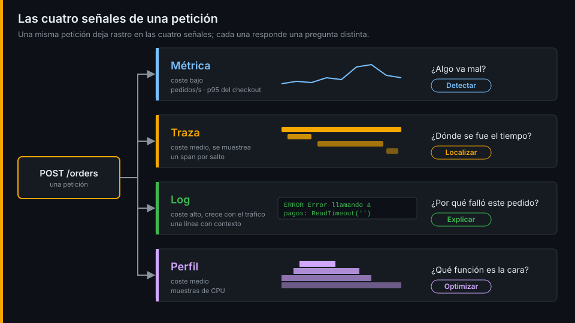
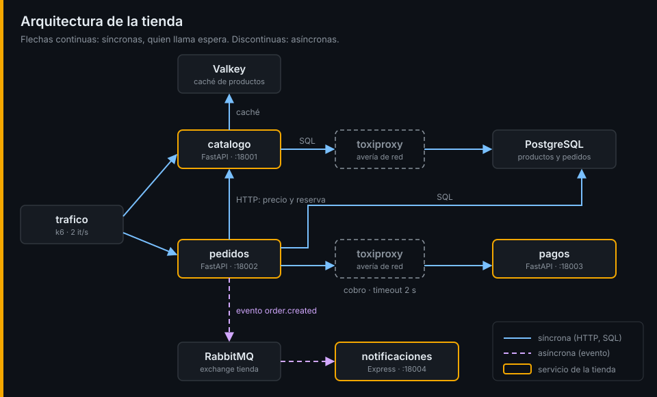

# Observabilidad y señales

## ¿Por qué importa esto?

Son las tres de la mañana y el checkout de la tienda devuelve errores. El dashboard dice "CPU al 20 %, todo verde". Los clientes dicen otra cosa. El problema no es que te falten gráficas: es que nadie previó **esta** pregunta, así que nadie guardó los datos para responderla. La observabilidad trata de poder responder preguntas que no previste sin desplegar código nuevo.

## Monitoreo frente a observabilidad

| | Monitoreo | Observabilidad |
|---|---|---|
| Pregunta | ¿Está pasando X? | ¿Qué está pasando y por qué? |
| Tipo de fallo | Conocido de antemano (*known unknowns*) | Nuevo (*unknown unknowns*) |
| Forma | Umbrales y dashboards fijos | Exploración con datos ricos en contexto |
| Ejemplo en la tienda | "Avisa si `pedidos` devuelve más de un 5 % de 5xx" | "¿Qué tienen en común los checkouts lentos de las últimas dos horas?" |

No compiten: el monitoreo te avisa de que algo va mal y la observabilidad te deja averiguar qué. Un sistema es observable cuando puedes deducir su estado interno a partir de lo que emite hacia fuera.

## Telemetría: las cuatro señales

Lo que un sistema emite para ser observado se llama **telemetría**. Se organiza en señales:

| Señal | Qué es | Responde | Coste | En la tienda |
|---|---|---|---|---|
| Logs | Un registro por evento, con contexto | ¿Qué pasó exactamente en esta petición? | Alto: crece con el tráfico | `Error llamando a pagos: ReadTimeout` |
| Métricas | Números agregados en el tiempo | ¿Cuánto, con qué frecuencia, qué tendencia? | Bajo y predecible | Pedidos por segundo, p95 del checkout |
| Trazas | El recorrido de una petición por todos los servicios | ¿Dónde se fue el tiempo? ¿Quién llamó a quién? | Medio: se muestrea | `pedidos → catalogo → pagos → RabbitMQ → notificaciones` |
| Perfiles | Dónde gasta CPU y memoria el código | ¿Qué función es la cara? | Medio | La búsqueda de `catalogo` |

Ninguna señal sobra. Las métricas detectan barato, las trazas localizan, los logs explican y los perfiles bajan hasta la línea de código. Este bootcamp las añade a la tienda en ese orden.



## Cardinalidad

La **cardinalidad** es el número de valores distintos de un atributo. `status_code` tiene pocos (200, 402, 503...); `email` tiene tantos como clientes. En métricas, cada combinación de valores es una serie temporal distinta, así que un atributo de alta cardinalidad multiplica el coste. En logs y trazas, en cambio, el contexto detallado es justo lo que permite investigar. Saber dónde va cada atributo es una de las decisiones centrales de la semana 03 en adelante.

## Un estándar: OpenTelemetry

Durante años cada herramienta tuvo su propio formato de telemetría. OpenTelemetry (proyecto de la CNCF) define una API, unos SDK y un protocolo (OTLP) comunes para las cuatro señales. Instrumentas una vez y eliges el backend después: Prometheus, Loki, Jaeger, Tempo o el que venga. Lo usarás desde la semana 09.

## Lo que tiene la tienda hoy



Nada de lo anterior. Logs de texto plano sin contexto, ningún `/metrics`, ninguna traza. Esta semana vas a sufrir esa ausencia a propósito, para que cada señal que añadas después responda a un dolor que ya conoces.

```bash
curl -s -o /dev/null -w '%{http_code}\n' http://127.0.0.1:18001/metrics   # 404
```

Listo. Ve al [lab-01](../2-practicas/lab-01-levantar-la-tienda/README.md) y ponlo en práctica.

---

[← Semana 01](../README.md) · [RED, USE y golden signals →](02-red-use-y-golden-signals.md)
