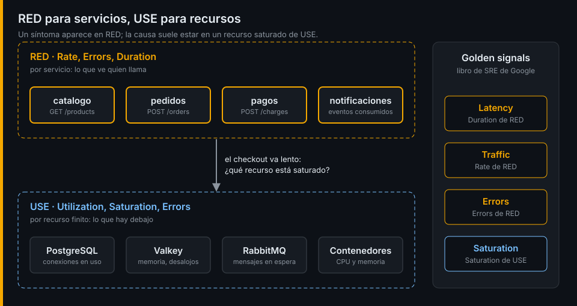

# RED, USE y golden signals

## ¿Por qué importa esto?

Ante un sistema nuevo, la pregunta "¿qué mido?" paraliza: todo parece importante. Tres métodos responden con una lista corta y probada. Aplicarlos a la tienda te da el 80 % de lo que necesitas antes de escribir una sola línea de instrumentación.

## RED: para servicios

Tom Wilkie lo propuso para microservicios. Para **cada servicio** que atiende peticiones:

| Letra | Qué | Ejemplo en `pedidos` |
|---|---|---|
| **R**ate | Peticiones por segundo | `POST /orders` por segundo |
| **E**rrors | Peticiones que fallan | Respuestas 5xx |
| **D**uration | Cuánto tardan, como distribución | p50, p95 y p99 de `POST /orders` |

Dos matices que importan:

- **Qué es un error lo decides tú.** Un 402 de `pedidos` es un cobro rechazado: el sistema funcionó y dijo que no. Un 503 es el sistema fallando. Mézclalos y tu tasa de errores mentirá.
- **La duración es una distribución, no una media.** Si 99 checkouts tardan 100 ms y uno tarda 10 s, la media dice 199 ms y nadie se queja; el cliente del percentil 99 sí.

## USE: para recursos

Brendan Gregg lo propuso para analizar rendimiento. Para **cada recurso** (CPU, memoria, disco, un pool de conexiones, una cola):

| Letra | Qué | Ejemplo en PostgreSQL |
|---|---|---|
| **U**tilization | Fracción del tiempo o de la capacidad en uso | Conexiones usadas frente a `max_connections` |
| **S**aturation | Trabajo que espera porque el recurso no da más | Sesiones esperando un lock |
| **E**rrors | Fallos del recurso | Rollbacks, deadlocks |

RED mira el servicio desde fuera, como lo ve el cliente. USE mira lo que hay debajo. Cuando RED dice "el checkout va lento", USE te dice si es porque la cola o la base de datos están saturadas.

## Golden signals

El libro de SRE de Google propone cuatro señales para cualquier sistema orientado a usuarios:

| Golden signal | Equivale a |
|---|---|
| Latency | Duration de RED |
| Traffic | Rate de RED |
| Errors | Errors de RED |
| Saturation | Saturation de USE |

Son RED más la saturación. Si solo pudieras medir cuatro cosas, serían estas.



## SLIs

Un **SLI** (*service level indicator*) es una medida de lo bien que funciona un servicio desde el punto de vista del usuario. La forma más útil es una proporción:

```
SLI = eventos buenos / eventos totales
```

| SLI | Eventos buenos | Eventos totales |
|---|---|---|
| Disponibilidad del checkout | `POST /orders` sin 5xx | Todas las `POST /orders` |
| Latencia del checkout | `POST /orders` en menos de 1 s | Todas las `POST /orders` |

Una proporción va de 0 a 1, se entiende sin contexto y se puede comparar con un objetivo. En la semana 15 convertirás estos SLIs en SLOs con presupuesto de error. Esta semana solo eliges cuáles.

## Lo que puedes medir hoy

Casi nada de RED: los logs de acceso de la tienda tienen la ruta y el código de estado, pero no la duración. De USE, bastante más: PostgreSQL, Valkey y RabbitMQ ya exponen sus estadísticas. Lo comprobarás en el lab 05.

---

[← Observabilidad y señales](01-observabilidad-y-senales.md) · [Prácticas →](../2-practicas/README.md)
