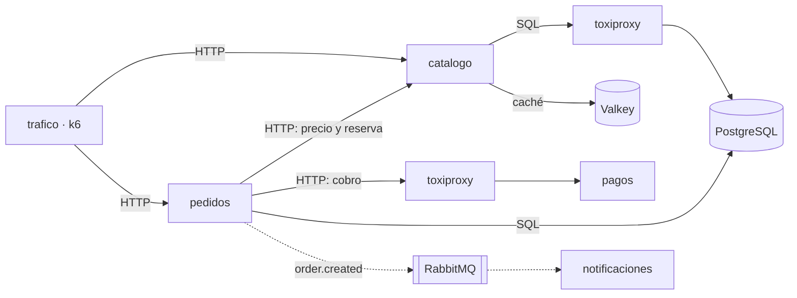

# Notas del lab 01 (SOLUCIÓN)

## Diagrama de la tienda

## Preguntas

1. ¿Qué servicios llama `pedidos` para completar un checkout, y en qué orden?
   Por cada producto, `catalogo` dos veces: `GET /products/{id}` para el precio y `POST /products/{id}/reserve` para el stock. Después `pagos` (`POST /charges`) a través de toxiproxy. Luego guarda el pedido en PostgreSQL y, si se cobró, publica `order.created` en RabbitMQ.

2. ¿Qué devuelve `POST /orders` cuando el cobro falla? ¿Se guarda el pedido?
   Devuelve 402 con el `id` del pedido y `status: payment_failed`. Sí se guarda, con ese estado, y antes se libera el stock reservado.

3. ¿Cómo llega el pedido a `notificaciones`? ¿Espera `pedidos` a que se envíe el correo?
   Por RabbitMQ: `pedidos` publica en el exchange `tienda` con la clave `order.created` y `notificaciones` consume de la cola `notificaciones.order-created`. `pedidos` no espera: responde al cliente en cuanto publica.

4. ¿Qué piezas de la tienda guardan estado y cuáles no?
   Con estado: PostgreSQL (productos, stock, pedidos), RabbitMQ (mensajes pendientes) y Valkey (caché, se puede perder). Sin estado: los cuatro servicios. `pagos` guarda la configuración de averías en memoria y la pierde al reiniciarse.

5. Mira `docker compose -f app/compose.yaml logs --tail 20 pedidos`. ¿Qué información útil hay? ¿Qué echas en falta?
   Hay ruta, método y código de estado de cada petición, y una línea por pedido nuevo. Falta la duración, un identificador que una la línea del pedido con su línea de acceso y con lo que pasó en `catalogo` y `pagos`, y un formato que se pueda filtrar sin regex. Y sobra algo grave: el email y el número de tarjeta en claro.
