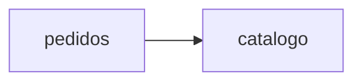

# Notas del lab 01

## Diagrama de la tienda

TODO: dibuja en Mermaid todas las piezas y cómo se comunican. Distingue las llamadas síncronas de las asíncronas.

## Preguntas

1. ¿Qué servicios llama `pedidos` para completar un checkout, y en qué orden?
   TODO

2. ¿Qué devuelve `POST /orders` cuando el cobro falla? ¿Se guarda el pedido?
   TODO

3. ¿Cómo llega el pedido a `notificaciones`? ¿Espera `pedidos` a que se envíe el correo?
   TODO

4. ¿Qué piezas de la tienda guardan estado y cuáles no?
   TODO

5. Mira `docker compose -f app/compose.yaml logs --tail 20 pedidos`. ¿Qué información útil hay? ¿Qué echas en falta?
   TODO
