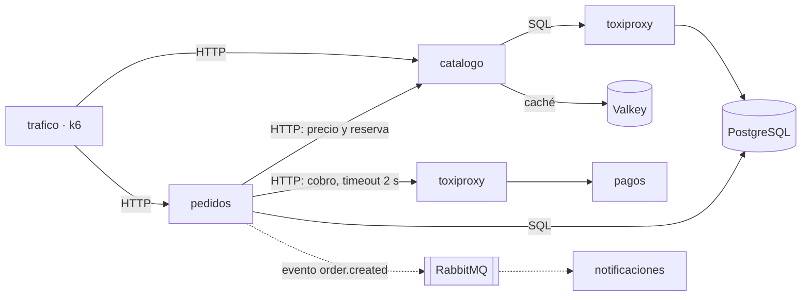

# Mapa de observabilidad — tienda

> Rellena cada sección. Respeta los encabezados `##` y el formato de las tablas: el autograding los lee.

## Arquitectura

Las flechas continuas son llamadas HTTP síncronas: quien llama espera la respuesta. La discontinua es asíncrona: `pedidos` publica el evento y no espera a `notificaciones`. toxiproxy está en medio de dos conexiones para poder inyectar averías de red.

## Preguntas

- ¿Cuántos pedidos por segundo entran y cuántos fallan?
- ¿Qué fracción de los pedidos fallidos se debe a `pagos` y qué fracción a `catalogo`?
- ¿Cuánto tarda un checkout en el percentil 50, 95 y 99?
- ¿Qué paso del checkout (precio, reserva, cobro, guardado) aporta más latencia?
- ¿Cuántos cobros aprueba `pagos` en pedidos que `pedidos` marca como fallidos?
- ¿Cuántos mensajes esperan en la cola de `notificaciones` y cuánto tarda un correo desde que se paga?
- ¿Qué porcentaje de las lecturas de producto sirve la caché de Valkey?
- ¿Qué consultas SQL consumen más tiempo en PostgreSQL?
- ¿Cuántas conexiones del pool de PostgreSQL usa cada servicio?
- ¿Qué búsquedas del catálogo son las más lentas y por qué?
- ¿Qué cambió (código, configuración, avería) justo antes de que empeorara?

## RED por servicio

| Servicio | Rate | Errors | Duration |
|---|---|---|---|
| catalogo | Peticiones/s por endpoint (`/products`, `/products/{id}`, `reserve`, `release`) | Respuestas 5xx; los 404 y 409 son respuestas de negocio | p50/p95/p99 por endpoint, con la búsqueda `?q=` aparte |
| pedidos | `POST /orders` por segundo | Respuestas 5xx; los 402 (cobro rechazado) se cuentan aparte | p95 de `POST /orders`, desglosado por llamada saliente |
| pagos | `POST /charges` por segundo | Respuestas 503 | p95 de `POST /charges` medido en `pagos` y en `pedidos` (la diferencia es la red) |
| notificaciones | Eventos consumidos por segundo | Mensajes descartados (`nack`) | Tiempo desde que se publica el evento hasta que se envía el correo |

## USE por recurso

| Recurso | Utilization | Saturation | Errors |
|---|---|---|---|
| PostgreSQL | Conexiones en uso frente a `max_connections` | Sesiones esperando un lock | Rollbacks y deadlocks en `pg_stat_database` |
| Valkey | Memoria usada y clientes conectados | Clientes bloqueados y claves desalojadas | Conexiones rechazadas |
| RabbitMQ | Consumidores activos de la cola | Mensajes `ready` esperando consumidor | Mensajes descartados por `notificaciones` |
| Contenedores | CPU y memoria frente a su límite (`docker stats`) | Throttling de CPU | Reinicios y muertes por OOM |

## SLIs candidatos

| SLI | Eventos buenos | Eventos totales | Servicio |
|---|---|---|---|
| Disponibilidad del checkout | `POST /orders` que no responden 5xx | Todas las `POST /orders` | pedidos |
| Latencia del checkout | `POST /orders` que responden en menos de 1 s | Todas las `POST /orders` | pedidos |
| Disponibilidad del catálogo | Peticiones a `/products` que no responden 5xx | Todas las peticiones a `/products` | catalogo |
| Frescura de las notificaciones | Correos enviados menos de 30 s después de pagar | Todos los pedidos pagados | notificaciones |

## Plan de instrumentación

| Semana | Señal | Qué añade a la tienda |
|---|---|---|
| 02 | Logs | JSON con esquema común y `request_id` de punta a punta; sin datos personales |
| 03 | Métricas | `/metrics` con RED en los cuatro servicios y Prometheus recogiéndolas |
| 07 | Métricas | Alertas sobre síntomas (errores y latencia del checkout) |
| 08 | Logs | Logs centralizados en Loki |
| 09-10 | Trazas | Trazas de punta a punta, incluida la ruta asíncrona hasta `notificaciones` |
| 12 | Todas | Correlación métrica → traza → logs |
| 14 | Perfiles | Perfiles de CPU para encontrar el coste de la búsqueda |
| 15 | Métricas | SLOs sobre los SLIs de este mapa |
