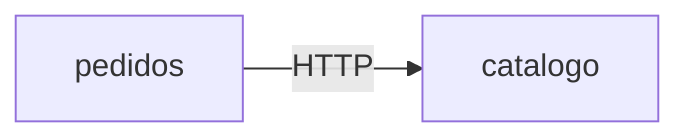

# Mapa de observabilidad — tienda

> Rellena cada sección. Respeta los encabezados `##` y el formato de las tablas: el autograding los lee.

## Arquitectura

<!-- TODO: completa el diagrama con todos los servicios y dependencias de la tienda,
     y distingue las llamadas síncronas (HTTP) de las asíncronas (eventos). -->

## Preguntas

Preguntas que la tienda tiene que poder responder cuando algo va mal. Una por línea, empezando por `- ` y terminando en `?`.

- ¿Cuántos pedidos por segundo entran y cuántos fallan?
- TODO: escribe al menos 7 preguntas más

## RED por servicio

| Servicio | Rate | Errors | Duration |
|---|---|---|---|
| catalogo | | | |

## USE por recurso

| Recurso | Utilization | Saturation | Errors |
|---|---|---|---|
| PostgreSQL | | | |

## SLIs candidatos

| SLI | Eventos buenos | Eventos totales | Servicio |
|---|---|---|---|
| Disponibilidad del checkout | `POST /orders` que no responden 5xx | Todas las `POST /orders` | pedidos |
| | | | |

## Plan de instrumentación

| Semana | Señal | Qué añade a la tienda |
|---|---|---|
| 02 | Logs | TODO |
