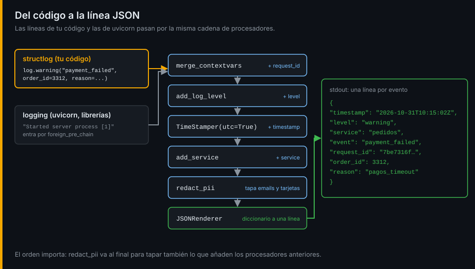
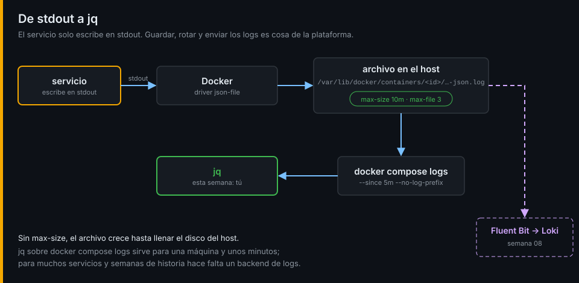

# Logs estructurados

## ¿Por qué importa esto?

En la semana 01 contaste errores con `grep '" 503 '` y cruzaste dos servicios a ojo. Funcionó porque la tienda es pequeña y tú la conocías. Con un formato distinto por servicio, un mensaje que cambia de redacción o diez servicios más, esas expresiones regulares se rompen sin avisar. Un log estructurado es un registro que una máquina puede leer sin adivinar: cada dato en su campo y con su tipo.



## Texto frente a estructura

```text
INFO:     192.168.48.10:40672 - "POST /orders HTTP/1.1" 402 Payment Required
```

```json
{"timestamp": "2026-10-31T10:15:02.118Z", "level": "info", "service": "pedidos", "event": "http_request",
 "request_id": "7be7316f", "method": "POST", "route": "/orders", "status_code": 402, "duration_ms": 2004.3}
```

La segunda línea responde, sin regex, a "¿cuántos 402 tardaron más de un segundo?":

```bash
jq -s 'map(select(.status_code == 402 and .duration_ms > 1000)) | length'
```

## El esquema común de la tienda

| Campo | Siempre | Ejemplo | Para qué |
|---|:--:|---|---|
| `timestamp` | sí | `2026-10-31T10:15:02.118Z` | Ordenar líneas de varios servicios. ISO 8601 y siempre en UTC |
| `level` | sí | `warning` | Filtrar por gravedad |
| `service` | sí | `pedidos` | Saber quién escribió la línea |
| `event` | sí | `payment_failed` | Qué pasó, con un nombre fijo que se puede contar |
| `request_id` | en peticiones | `7be7316f…` | Unir todas las líneas de una petición |

La regla de oro: **`event` es un nombre, no una frase**. `payment_failed` con `reason: "pagos_timeout"` se agrupa y se cuenta; `"El pago del pedido 3312 falló por timeout"` no.

## Niveles

| Nivel | Cuándo | En la tienda |
|---|---|---|
| `debug` | Detalle para depurar; apagado en producción | Acierto o fallo de caché |
| `info` | Algo normal que conviene saber | Pedido creado |
| `warning` | Algo salió mal y el sistema lo manejó | Cobro rechazado: el pedido queda en `payment_failed` |
| `error` | Algo falló y alguien debería mirarlo | `pagos` no está disponible |
| `critical` | El servicio no puede seguir | Se perdió la conexión con RabbitMQ |

El nivel mínimo se elige al arrancar (`LOG_LEVEL`), no en el código.

## structlog y pino

Los dos construyen cada línea como un diccionario que pasa por una cadena de procesadores y termina en JSON:

```python
log = structlog.get_logger()
log.warning("payment_failed", order_id=3312, reason="pagos_timeout")
```

```js
logger.warn({ order_id: 3312, reason: "pagos_timeout" }, "payment_failed");
```

Sus valores por defecto no coinciden (pino escribe `msg`, `time` en milisegundos y el nivel como número), así que el esquema común se impone en la configuración de cada uno, una sola vez.

## stdout y el driver de Docker

Un servicio en un contenedor escribe sus logs en stdout y nada más: ni archivos propios ni rotación propia. Docker los recoge con su driver de logging, por defecto `json-file`, que los guarda en el host. Sin `max-size` y `max-file`, ese archivo crece sin límite. Llevarlos a un sistema central (Loki) es la semana 08.



Listo. Ve al [lab-01](../2-practicas/lab-01-logs-json-con-structlog/README.md) y ponlo en práctica.

---

[← Semana 02](../README.md) · [Contexto y datos personales →](02-contexto-y-datos-personales.md)
