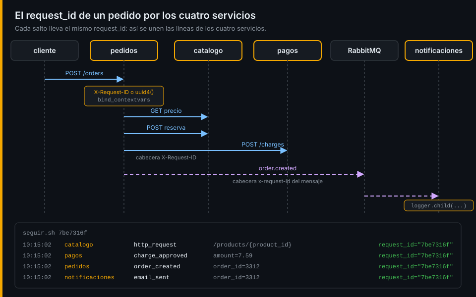

# Contexto y datos personales

## ¿Por qué importa esto?

Un log suelto dice qué pasó en un sitio. Para entender un pedido necesitas todas sus líneas, en todos los servicios, y solo esas. Y cada línea que escribes se copia a disco, a backups y a las pantallas de quien investiga: si lleva un email o una tarjeta, has creado un problema legal que no se borra con un `git revert`.

## request_id: una petición, un identificador

El primer servicio que recibe la petición le asigna un identificador. Si el cliente ya trae uno en `X-Request-ID`, se respeta. Desde ahí, todo lo que se escribe mientras dura la petición lo lleva.

Escribirlo a mano en cada llamada no escala. structlog lo resuelve con variables de contexto:

```python
structlog.contextvars.clear_contextvars()
structlog.contextvars.bind_contextvars(request_id=request_id)
log.info("order_created", order_id=3312)   # sale con request_id sin pasarlo
```

Cada petición `async` tiene su propio contexto, así que dos pedidos simultáneos no se mezclan. En pino, el equivalente es un logger hijo: `logger.child({ request_id })`.

## Propagación



El identificador tiene que viajar con cada llamada saliente:

| Salto | Cómo viaja | Quién lo lee |
|---|---|---|
| HTTP (`pedidos` → `catalogo`, `pagos`) | Cabecera `X-Request-ID` | El middleware del servicio que recibe |
| RabbitMQ (`pedidos` → `notificaciones`) | Cabecera `x-request-id` del mensaje | El consumidor, al recibir cada mensaje |

Si un salto se olvida, la cadena se corta ahí y el resto del recorrido vuelve a ser invisible. Por eso se propaga en un único punto (un hook del cliente HTTP) y no en cada llamada.

Esto es una versión manual de la propagación de contexto. En la semana 09 la sustituirá la cabecera estándar `traceparent` de W3C Trace Context, que además de identificar la petición identifica cada salto.

## Qué no se escribe nunca en un log

| Dato | Por qué | Qué escribir en su lugar |
|---|---|---|
| Email, nombre, teléfono, dirección | Datos personales: la ley limita quién los ve y cuánto se guardan | El identificador interno (`order_id`, `customer_id`) |
| Número de tarjeta | Normativa de pagos: no puede guardarse en claro | Nada, o los cuatro últimos dígitos si el negocio lo exige |
| Contraseñas, tokens, cabeceras `Authorization` | Quien lee el log puede suplantar al usuario | Nada |
| El cuerpo completo de una petición | Acaba conteniendo todo lo anterior | Los campos concretos que necesitas |

## Redacción: la red, no la solución

La solución es no escribir el dato. Pero alguien acabará escribiendo `log.info("debug", customer=order.customer)`, así que se añade una red al final de la cadena:

- **Por clave**: los campos que se llaman `email`, `card_number`, `password` o `token` salen como `[REDACTED]`. pino lo hace con su opción `redact`.
- **Por contenido**: los textos que contienen algo con forma de email o de tarjeta se tapan con una expresión regular. Es más caro y da falsos positivos, pero atrapa lo que se cuela en un texto libre.

Ninguna red es perfecta: se comprueba con una búsqueda periódica en los logs, como la del autograding de esta semana.

Listo. Ve al [lab-02](../2-practicas/lab-02-middleware-con-contexto/README.md) y ponlo en práctica.

---

[← Logs estructurados](01-logs-estructurados.md) · [Prácticas →](../2-practicas/README.md)
