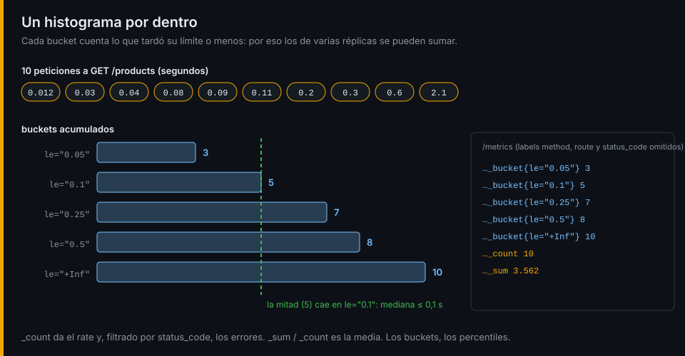

# Métricas y sus tipos

## ¿Por qué importa esto?

Con los logs de la semana 02 sabes qué le pasó a un pedido concreto. Para saber cuántos pedidos fallan por segundo tienes que leer y contar todas las líneas, y eso cuesta más cuanto más tráfico hay. Una métrica es un número que el propio servicio mantiene al día: contar mil pedidos o un millón cuesta lo mismo, y Prometheus solo tiene que leerlo cada 15 segundos.

## El modelo de datos

Una **serie** es un nombre de métrica más un conjunto de labels. Cada lectura le añade una muestra: un valor con su instante.

```text
http_server_request_duration_seconds_count{method="POST", route="/orders", status_code="402"}  57
└──────────── nombre ───────────────┘ └──────────────────── labels ─────────────────────┘  valor
```

Cada combinación distinta de labels es otra serie. Esa es la regla que más cuesta aprender: **los labels tienen que tener pocos valores**. `status_code` tiene unos pocos; un email, un id de pedido o una URL completa tienen infinitos.

## Los cuatro tipos

| Tipo | Qué hace | Ejemplo en la tienda | Se consulta con |
|---|---|---|---|
| Counter | Solo sube; vuelve a 0 al reiniciar | `orders_created_total` | Cuánto sube por segundo (`rate`, semana 04) |
| Gauge | Sube y baja | `http_server_active_requests` | Su valor |
| Histogram | Cuenta cada observación en buckets, más su suma y su número | `http_server_request_duration_seconds` | Rate, errores y percentiles |
| Summary | Calcula percentiles en el propio proceso | `nodejs_eventloop_lag_p99_seconds` | Su valor, pero no se puede agregar |

Un histograma da RED de un endpoint con una sola métrica: `_count` es el rate, `_count` con `status_code="5.."` son los errores y los buckets dan la duración.



Los buckets son acumulados: `le="0.25"` cuenta todo lo que tardó 250 ms **o menos**. Por eso se pueden sumar los de varias réplicas o varios servicios, siempre que usen los mismos límites. Un summary ya trae el percentil calculado, y la media de dos percentiles no es el percentil de la suma: el histograma es la opción por defecto.

## Nombres

| Regla | Bien | Mal |
|---|---|---|
| Unidad base del SI en el nombre | `_seconds`, `_bytes` | `_ms`, `_kb` |
| Los counters acaban en `_total` | `payment_failures_total` | `payment_failures` |
| `snake_case`, en inglés, con prefijo de dominio | `catalog_cache_requests_total` | `cacheHits` |
| Lo que varía va en un label, no en el nombre | `notifications_total{result="sent"}` | `notifications_sent_total` y `notifications_discarded_total` |

Los nombres HTTP de la tienda siguen las [convenciones de OpenTelemetry](https://opentelemetry.io/docs/specs/semconv/http/http-metrics/): en la semana 10 el SDK generará el mismo `http_server_request_duration_seconds` y tus consultas seguirán valiendo.

## Ejemplo mínimo

Pégalo en `uv run --with prometheus-client python`:

```python
from prometheus_client import CollectorRegistry, Counter, generate_latest

registry = CollectorRegistry()
orders = Counter("orders_created_total", "Pedidos creados", registry=registry)
orders.inc()
print(generate_latest(registry).decode())
```

```text
# HELP orders_created_total Pedidos creados
# TYPE orders_created_total counter
orders_created_total 1.0
# HELP orders_created_created Pedidos creados
# TYPE orders_created_created gauge
orders_created_created 1.7935016817378604e+09
```

La serie `_created` (cuándo nació el contador) la añade el cliente de Python a cada counter e histograma. Prometheus no la necesita y duplica las series: la tienda la desactiva en el lab 01.

Cada servicio expone así sus métricas en `/metrics`, en texto plano. Cómo llegan a Prometheus está en la [siguiente lectura](02-prometheus-y-descubrimiento.md); lo pones en práctica desde el [lab-01](../2-practicas/lab-01-primer-metrics/README.md).

---

[← Semana 03](../README.md) · [Prometheus y descubrimiento →](02-prometheus-y-descubrimiento.md)
