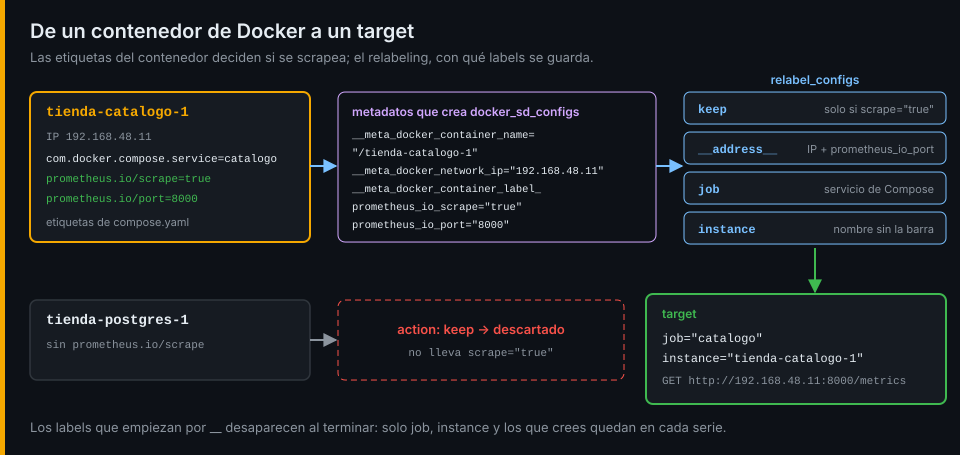

# Prometheus y descubrimiento

## ¿Por qué importa esto?

Un `/metrics` que nadie lee no sirve de nada. Prometheus lee cada uno cada 15 segundos y guarda las muestras para que puedas preguntar por ellas. Para eso tiene que saber qué leer, y en un sistema donde los contenedores se recrean y cambian de IP, una lista escrita a mano está mal en cuanto la terminas.

## Pull frente a push

Prometheus va a buscar las métricas (*pull*): cada servicio solo las mantiene en memoria y las sirve en `/metrics`. Cada lectura es un *scrape*, y cada dirección que se lee, un *target*.

| | Pull (Prometheus) | Push |
|---|---|---|
| ¿Quién inicia? | Prometheus | El servicio |
| Servicio caído | `up` vale 0: lo sabes gratis | Silencio: ¿caído o sin tráfico? |
| Configuración | En un solo sitio | En cada servicio |
| Procesos que viven segundos | Terminan antes del siguiente scrape | Bien |

Para un *job* por lotes que vive segundos existe **Pushgateway**: el job empuja su resultado y Prometheus lo lee de ahí. Solo sirve para eso. Si lo usas para servicios normales, pierdes `up` y el Pushgateway guarda el último valor para siempre, aunque el servicio haya muerto. La tienda no lo necesita.

## Descubrir los targets



`docker_sd_configs` le pide a Docker la lista de contenedores y crea un target por cada uno con metadatos: `__meta_docker_container_name`, `__meta_docker_network_ip`, las etiquetas del contenedor... `relabel_configs` decide con ellos qué se scrapea y con qué labels:

```yaml
relabel_configs:
  - source_labels: [__meta_docker_container_label_prometheus_io_scrape]
    regex: "true"
    action: keep                        # el resto de targets se descarta
  - source_labels: [__meta_docker_container_label_com_docker_compose_service]
    target_label: job                   # job="catalogo"
```

| Paso | Cuándo se aplica | Para qué |
|---|---|---|
| `relabel_configs` | Antes del scrape, a cada target | Elegir targets y ponerles `job`, `instance` y otros labels |
| `metric_relabel_configs` | Después del scrape, a cada muestra | Descartar métricas o labels antes de guardarlos |

Los labels que empiezan por `__` desaparecen después del relabeling. Las dos excepciones útiles: `__address__`, que dice dónde se scrapea, y `__metrics_path__`.

## Exporters

Lo que no expone métricas por sí mismo necesita un **exporter** que traduzca:

| Exporter | Qué mide | Señal |
|---|---|---|
| node_exporter | CPU, memoria, disco y red del host | USE de la máquina |
| cAdvisor | CPU, memoria y red de cada contenedor, desde sus cgroups | USE de cada contenedor |

Los dos aportan muchas más series que tus servicios: cAdvisor sola, más que la tienda entera. Cada serie cuesta memoria en Prometheus, y por eso la cardinalidad se vigila desde el primer día.

## La configuración es código

`prometheus.yml` vive en tu copia de la tienda, se valida con `promtool check config` y se recarga sin reiniciar con `POST /-/reload`. Nunca se cambia nada desde la interfaz web, que además solo sirve para consultar.

Ve al [lab-01](../2-practicas/lab-01-primer-metrics/README.md) y empieza por el primer `/metrics`.

---

[← Métricas y sus tipos](01-metricas-y-tipos.md) · [Prácticas →](../2-practicas/README.md)
