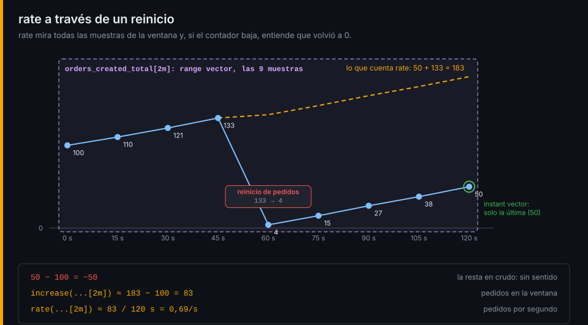

# Vectores, selectores y tasas

## ¿Por qué importa esto?

En la semana 03 la tienda empezó a guardar miles de series. Sin PromQL son solo números que suben. Con él, "¿cuántos pedidos fallan?" o "¿cuánto tarda un checkout?" se responden en una línea, y esa misma línea será un panel en la semana 06 y una alerta en la 07. Si la consulta está mal escrita, el panel y la alerta también lo estarán, y casi nunca darán error: darán un número falso.

## Instant vector y range vector

Toda consulta se evalúa en un instante (por defecto, ahora).

| Expresión | Tipo | Qué devuelve |
|---|---|---|
| `up` | instant vector | Por cada serie, su última muestra (si tiene menos de 5 minutos) |
| `up[5m]` | range vector | Por cada serie, todas sus muestras de los últimos 5 minutos |
| `rate(up[5m])` | instant vector | Una función convierte el rango en un valor por serie |
| `42` | scalar | Un número sin labels |

Un range vector no se dibuja ni se compara: siempre se le aplica una función. Con un `scrape_interval` de 15 s, `[1m]` contiene unas 4 muestras y `[5m]`, unas 20.

## Selectores

```promql
http_server_request_duration_seconds_count{job="pedidos", method="POST", route="/orders"}
up{job!~"node-exporter|cadvisor"}
{__name__=~"orders_.*"}
```

| Matcher | Significa |
|---|---|
| `=` / `!=` | igual / distinto |
| `=~` / `!~` | casa / no casa con la expresión regular |

Las expresiones regulares son RE2 y están **ancladas**: `route=~"/products"` solo casa con `/products` exacto; para el prefijo, `"/products.*"`. El nombre de la métrica es un label más, `__name__`.

## Tasas: rate, irate e increase



El valor de un counter depende de cuándo arrancó el proceso. Lo que interesa es cuánto sube:

| Función | Devuelve | Úsala para |
|---|---|---|
| `rate(x[5m])` | Aumento por segundo, promedio de la ventana | Dashboards y alertas: casi siempre |
| `irate(x[5m])` | Aumento por segundo entre las dos últimas muestras | Ver picos en un zoom corto |
| `increase(x[1h])` | Aumento total en la ventana (`rate × segundos`) | "¿Cuántos en la última hora?" |
| `resets(x[1h])` | Veces que el contador bajó | Contar reinicios |

Las tres primeras detectan los reinicios: si una muestra es menor que la anterior, entienden que el contador volvió a 0 y suman el valor previo. Por eso:

- **Nunca sobre un gauge.** Cada bajada se interpretaría como un reinicio. Para la tendencia de un gauge, `deriv()` o `delta()`.
- **Primero `rate`, después `sum`.** Si sumas antes, el reinicio de un servicio se confunde con el de todos.
- **La ventana, al menos cuatro veces el `scrape_interval`.** `rate` necesita dos muestras; con `[20s]` a veces no las hay.

`increase` casi nunca da un entero: Prometheus extrapola la tasa hasta los bordes de la ventana, porque las muestras no caen justo en ellos.

## Un ejemplo que funciona

Con la tienda de la semana en marcha, desde la raíz del repositorio:

```bash
./scripts/promql.sh 'sum(rate(http_server_request_duration_seconds_count{job="pedidos", method="POST", route="/orders"}[5m]))'
# {} 0.4975
```

Medio pedido por segundo: los que entran, se paguen o no. Cómo agregar por servicio, dividir y calcular percentiles está en la [siguiente lectura](02-agregaciones-y-percentiles.md); lo practicas desde el [lab-01](../2-practicas/lab-01-selectores/README.md).

---

[← Semana 04](../README.md) · [Agregaciones y percentiles →](02-agregaciones-y-percentiles.md)
