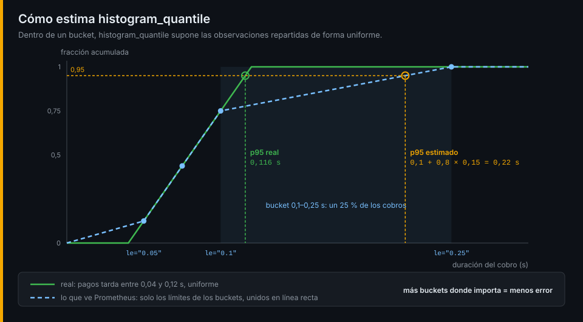

# Agregaciones y percentiles

## ¿Por qué importa esto?

`rate` devuelve una serie por cada combinación de labels: por servicio, instancia, método, ruta y código. Nadie mira 40 líneas. Las preguntas de la semana 01 piden una cifra (los pedidos que fallan), una por servicio (los 5xx de cada uno) o un percentil (cuánto espera el cliente más lento). Eso es agregar, dividir y calcular cuantiles.

## Agregación

```promql
sum by (job) (rate(http_server_request_duration_seconds_count[5m]))
sum without (instance, method, status_code) (rate(http_server_request_duration_seconds_count[5m]))
topk(3, sum by (job, route) (rate(http_server_request_duration_seconds_count[5m])))
```

| Operador | Hace |
|---|---|
| `sum`, `avg`, `min`, `max` | Combina las series en una por grupo |
| `count` | Cuántas series hay en cada grupo |
| `topk(k, …)` / `bottomk` | Las k series con más / menos valor |
| `by (labels)` | Conserva solo esos labels |
| `without (labels)` | Quita esos y conserva el resto |

## Aritmética entre vectores

`a / b` empareja las series de los dos lados que tienen **exactamente los mismos labels**. Las que no tienen pareja desaparecen, sin error. El patrón de toda proporción es agregar los dos lados igual y dividir:

```promql
  sum by (job) (rate(http_server_request_duration_seconds_count{status_code=~"5.."}[5m]))
/
  sum by (job) (rate(http_server_request_duration_seconds_count[5m]))
```

Las comparaciones (`>`, `==`…) **filtran**: devuelven las series que las cumplen. Con `bool` devuelven 1 o 0. Emparejar lados con labels distintos (`on`, `ignoring`, `group_left`) es de la semana 05.

## Percentiles con histogram_quantile



```promql
histogram_quantile(0.95,
  sum by (le) (rate(http_server_request_duration_seconds_bucket{job="pedidos", route="/orders"}[5m]))
)
```

1. `rate` de cada bucket: cuántas peticiones por segundo caben en cada límite.
2. `sum by (le, …)`: se suman los buckets de todas las instancias. **`le` siempre en el `by`**; añade lo que quieras conservar (`job`, `route`).
3. `histogram_quantile` busca el bucket donde se cruza el 95 % y **interpola** suponiendo un reparto uniforme dentro de él.

El resultado es tan preciso como lo estrechos que sean los buckets alrededor del valor. Si el percentil cae en `+Inf`, devuelve el último límite finito. Y los percentiles **no se promedian**: la media del p95 de dos servicios no es el p95 de ambos. Se suman los buckets y se calcula una vez. La media exacta sale de `rate(x_sum[5m]) / rate(x_count[5m])`.

## La API HTTP

Todo lo anterior se puede pedir desde la terminal:

| Endpoint | Para |
|---|---|
| `/api/v1/query?query=…&time=…` | Evaluar en un instante |
| `/api/v1/query_range?query=…&start=…&end=…&step=…` | Una serie de puntos: una gráfica |
| `/api/v1/series?match[]=…` | Qué series existen |
| `/api/v1/label/<label>/values` | Qué valores tiene un label |

```bash
curl -s 127.0.0.1:9090/api/v1/query --data-urlencode 'query=sum by (job) (up)' \
  | jq -r '.data.result[] | [.metric.job, .value[1]] | @tsv'
```

La respuesta trae `status`; si es `error`, `error` dice por qué. Los valores llegan como cadena porque pueden ser `NaN` o `+Inf`.

Ve al [lab-01](../2-practicas/lab-01-selectores/README.md) y empieza por los selectores.

---

[← Vectores, selectores y tasas](01-vectores-y-tasas.md) · [Prácticas →](../2-practicas/README.md)
