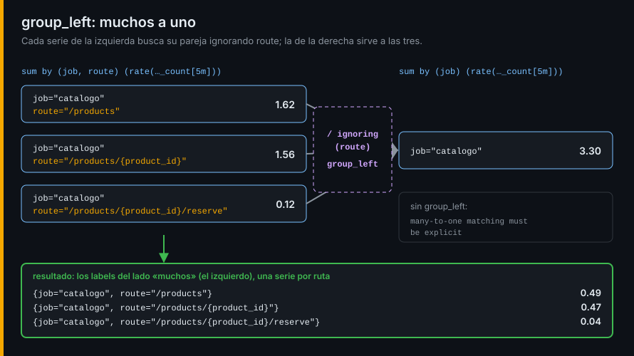

# Vector matching y el tiempo

## ¿Por qué importa esto?

Con lo de la semana 04 respondes preguntas sobre una métrica y sus mismos labels. Las preguntas de un incidente cruzan cosas: qué parte del tráfico se lleva cada ruta, qué versión corre en el servicio que falla, si hoy va peor que hace una hora, cuándo se llenará el disco, si un servicio ha dejado de reportar. Para eso hacen falta tres herramientas nuevas: emparejar series con labels distintos, mover la consulta en el tiempo y detectar lo que no está.

## Vector matching



| Forma | Empareja | Cuándo |
|---|---|---|
| `a / b` | Labels idénticos | Los dos lados agregados igual |
| `a / on(job) b` | Solo por `job` | Quieres decir con qué emparejar |
| `a / ignoring(route) b` | Por todos menos `route` | Sobra un label en un lado |
| `a / on(job) group_left b` | Varias de `a` con una de `b` | Muchos a uno |
| `a * on(job, instance) group_left(version) info` | Y copia `version` de `info` | Enriquecer con una métrica *info* |
| `a / on() group_left b` | Todas con la única de `b` | `b` es un total sin labels comunes |

Sin `group_left` o `group_right`, un emparejamiento muchos a uno da error: Prometheus no adivina.

## El tiempo

| Expresión | Qué hace |
|---|---|
| `rate(x[5m] offset 1h)` | Evalúa el selector una hora antes |
| `rate(x[5m] @ 1793500000)` | Lo evalúa en un instante absoluto |
| `x @ end()` | En el final del rango de una gráfica |
| `max_over_time(expr[1h:1m])` | Subconsulta: evalúa `expr` cada minuto durante una hora |

Una subconsulta convierte el resultado de cualquier consulta en un range vector, así que admite las funciones `_over_time`, `deriv` o `predict_linear`. Son caras: si se repiten, pasan a ser recording rules.

## Lo que no está y lo que vendrá

```promql
absent(up{job="pagos"})                                     # 1 si no existe ninguna serie
absent_over_time(orders_created_total[5m])                  # 1 si no ha habido muestras en 5 min
deriv(node_filesystem_avail_bytes{mountpoint="/"}[1h])      # pendiente por segundo de un gauge
predict_linear(node_filesystem_avail_bytes{mountpoint="/"}[1h], 4 * 3600) < 0   # se llena en 4 h
```

Una alerta sobre "errores > 0" no salta si el servicio deja de exponer métricas: `absent` cubre ese hueco. `deriv` y `predict_linear` son para gauges; sobre counters, `rate`.

## Native histograms

Un histograma clásico es una serie por bucket, con límites fijos. Un native histogram es una sola serie con todos sus buckets dentro, de límites exponenciales: más preciso y más barato. Se activan por scrape:

```yaml
scrape_native_histograms: true
always_scrape_classic_histograms: true   # conserva también los _bucket
```

Se consultan sin `_bucket` ni `le`: `histogram_quantile(0.9, sum(rate(x[5m])))`, y tienen funciones propias (`histogram_count`, `histogram_avg`, `histogram_fraction`). Los clientes de la tienda aún exponen clásicos; el propio Prometheus, las dos formas.

## Un ejemplo que funciona

```bash
./scripts/promql.sh 'up * on(job, instance) group_left(version) python_info'
# instance="tienda-pedidos-1",job="pedidos",version="3.14.10" 1
```

Lo practicas desde el [lab-01](../2-practicas/lab-01-vector-matching/README.md); las recording rules, en la [siguiente lectura](02-recording-rules-y-tests.md).

---

[← Semana 05](../README.md) · [Recording rules y tests →](02-recording-rules-y-tests.md)
