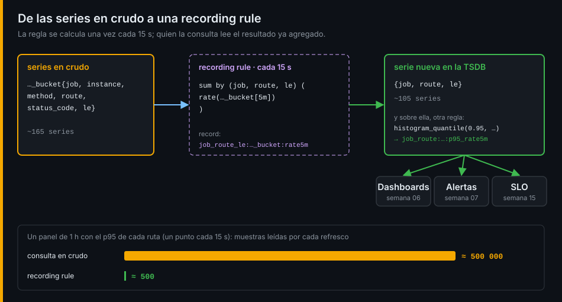

# Recording rules y tests

## ¿Por qué importa esto?

Un panel de una hora con el p95 de cada ruta de la tienda lee unas 500 000 muestras cada vez que se refresca. Con diez personas mirándolo y un refresco cada 30 s, Prometheus pasa el día recalculando lo mismo. Una recording rule lo calcula una vez cada 15 s y lo guarda: el mismo panel lee unas 500: mil veces menos. Y como dashboards, alertas y SLO van a depender de esas reglas, una regla rota es una alerta muda. Por eso llevan tests.

## Recording rules



```yaml
# prometheus.yml
global:
  evaluation_interval: 15s
rule_files:
  - rules/*.yml
```

```yaml
# rules/tienda.yml
groups:
  - name: tienda_red
    rules:
      - record: job:http_server_requests:rate5m
        expr: sum by (job) (rate(http_server_request_duration_seconds_count[5m]))
      - record: job:http_server_requests_errors:rate5m
        expr: sum by (job) (rate(http_server_request_duration_seconds_count{status_code=~"5.."}[5m]))
      - record: job:http_server_requests_errors:ratio_rate5m
        expr: job:http_server_requests_errors:rate5m / job:http_server_requests:rate5m
```

Las reglas de un grupo se evalúan en orden, así que una puede usar el resultado de otra. Los grupos se evalúan en paralelo.

## El nombre: level:metric:operations

| Parte | Qué dice | Ejemplo |
|---|---|---|
| *level* | Labels que conserva el resultado | `job`, `job_route`, `job_route_le` |
| *metric* | Métrica de origen, sin `_total` | `http_server_requests`, `orders_created` |
| *operations* | Lo aplicado, de dentro afuera | `rate5m`, `ratio_rate5m`, `p95_rate5m` |

Un nombre que miente es peor que ninguno: si el *level* dice `job`, el resultado tiene `job` y nada más.

## Qué merece una regla

- Lo que consultan dashboards y alertas sin parar: RED por servicio, percentiles por ruta.
- Las tasas de los buckets, no solo el percentil: de ellas sale cualquier otro percentil sin volver a los datos en crudo.
- Las subconsultas que se repiten.
- No las consultas que se hacen una vez al investigar: para eso está PromQL a mano.

## promtool

| Comando | Para |
|---|---|
| `promtool check config prometheus.yml` | Configuración y las reglas que carga |
| `promtool check rules rules/tienda.yml` | Solo las reglas |
| `promtool test rules tests/tienda_test.yml` | Tests unitarios |

Un test inventa series, evalúa las reglas en un instante y compara con lo que tú has calculado a mano:

```yaml
rule_files: [../rules/tienda.yml]
fuzzy_compare: true          # 0,8 y 0,7999999999999999 son iguales
tests:
  - interval: 15s
    input_series:
      - series: 'http_server_request_duration_seconds_count{job="pedidos", status_code="201"}'
        values: '0+9x40'      # +9 cada 15 s = 0,6/s
    promql_expr_test:
      - expr: job:http_server_requests:rate5m
        eval_time: 10m
        exp_samples:
          - labels: 'job:http_server_requests:rate5m{job="pedidos"}'
            value: 0.6
```

Un test solo vale si falla con la regla rota. Si tus series de entrada no tienen ningún 404, ningún test detectará que la regla cuenta los 4xx como errores.

## Cardinalidad

`curl -s 127.0.0.1:9090/api/v1/status/tsdb` devuelve el número de series y las métricas y labels que más aportan. Las recording rules también crean series: guarda las agregadas, no copias con los mismos labels que el original.

Ve al [lab-01](../2-practicas/lab-01-vector-matching/README.md) y empieza por el vector matching.

---

[← Vector matching y el tiempo](01-vector-matching-y-el-tiempo.md) · [Prácticas →](../2-practicas/README.md)
